  <picture>
    <source media="(max-width: 600px) and (prefers-color-scheme: light)" srcset=".github/assets/banner-phone-light.svg">
    <source media="(max-width: 600px)" srcset=".github/assets/banner-phone.svg">
    <source media="(prefers-color-scheme: light)" srcset=".github/assets/banner-light.svg">
    
  </picture>

 

Free tools for coding agents, privacy and documents, mostly in Rust.

## Tools

- [Puritanical](https://github.com/EquityBot/Puritanical): the smallest correct change, verified. A skill for Claude Code, Codex and other coding agents.
- [Laconic](https://github.com/EquityBot/Laconic): answer-first output and an AI-text humaniser in Australian English, for coding agents.
- [GhostSoap](https://github.com/EquityBot/GhostSoap): prepare Australian Privacy Act requests to data brokers, for you to send from your own mailbox.
- [Alcuin](https://github.com/EquityBot/Alcuin): ask ChatGPT, or the OpenAI or Azure OpenAI API, about your source files from a CLI or MCP server, and keep each answer.
- [DiogenesLamp](https://github.com/EquityBot/DiogenesLamp): archive Yupoo catalogues offline, with a local viewer.

## Forks

- [PlutarchPages](https://github.com/EquityBot/PlutarchPages): a pure Rust PDF workbench, from PdfCraft.
- [rgg](https://github.com/EquityBot/rgg): a distribution of RTK, which compresses command output before a coding agent reads it.
- [PamweChete](https://github.com/EquityBot/PamweChete): a pi coding-agent configuration to copy piece by piece (archived).

---

<i>Ad gloriam eius, non meam.</i>

